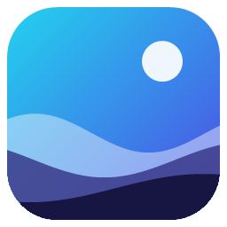
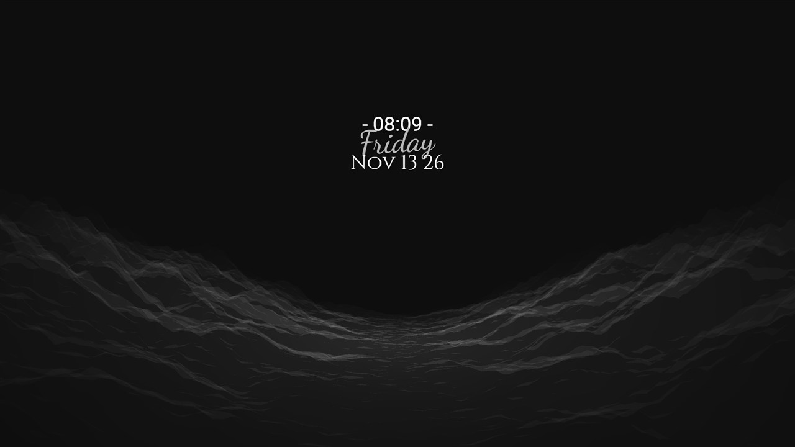
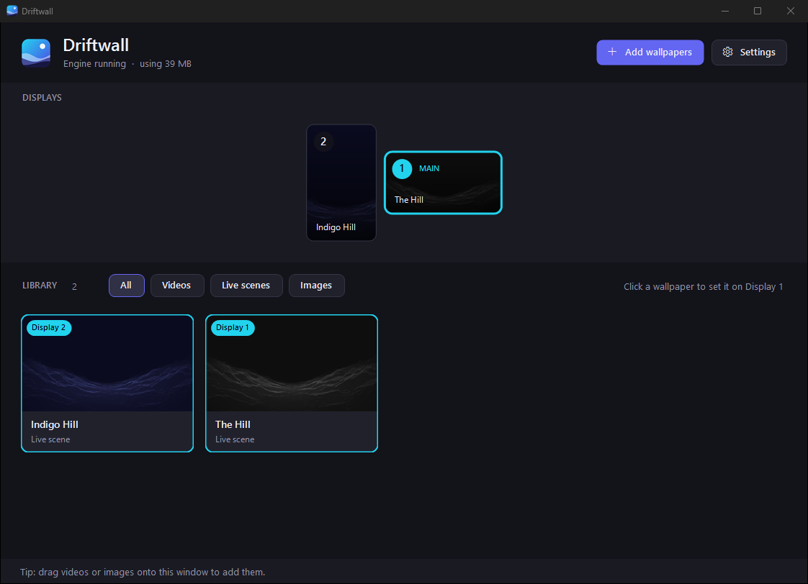

<p align="center">
  
</p>

<h1 align="center">Driftwall</h1>

<p align="center">
  <b>Lightweight live wallpapers for Windows.</b><br>
  Videos and animated scenes on every monitor, behind your desktop icons, for about 40&nbsp;MB of memory.
</p>

<p align="center">
  <a href="https://github.com/wahajahmed-ftw/driftwall/actions/workflows/build.yml"></a>
  <a href="LICENSE"></a>
  
</p>

<p align="center">
  
</p>

## Why Driftwall exists

Popular live wallpaper apps run each wallpaper inside a web browser engine or a game engine. That works, but it costs a lot: on the PC Driftwall was built on, Lively Wallpaper used **about 670&nbsp;MB of RAM** to show one video and one animated scene on two monitors, and the desktop felt slower for it.

Driftwall shows the same two wallpapers with **about 44&nbsp;MB**. It does this by skipping the browser altogether:

- **Videos** are decoded by your graphics card through Windows' own Media Foundation and copied straight to the screen.
- **Animated scenes** are written natively in Direct3D 11, not in HTML and JavaScript.
- **Still images** are handed to Windows itself, so they cost nothing at all.
- **Everything pauses** when a window covers the monitor, when the PC is locked and when the screen is off. While paused the engine uses no CPU.

## Features

- A different wallpaper on each monitor, including portrait and mixed-DPI setups.
- Add any **MP4, MOV, MKV, WebM, AVI or WMV** video, or a **JPG, PNG, WebP or BMP** image, by dragging it onto the window.
- **Every file is checked before it is added:** its type is identified from its content (never just its extension), and it is scanned with **Microsoft Defender**. Programs and anything Defender flags are rejected.
- A one-click import of your existing **Lively Wallpaper** video and image wallpapers.
- Starts with Windows. Survives Explorer restarts, monitor changes, sleep and resume, and GPU driver resets.
- A tray icon to pause, resume or quit.
- No network access, no telemetry and no account. Nothing leaves your PC.

<p align="center">
  
</p>

## Install

**Requirements:** 64-bit Windows 10 (version 1703 or later) or Windows 11, and any graphics card from the last decade (Direct3D 10 or newer). Tested on Windows 11 24H2.

1. Download the latest `Driftwall-x.y.z-win-x64.zip` from [Releases](https://github.com/wahajahmed-ftw/driftwall/releases) and unzip it.
2. Double-click **`install.cmd`**.

   This installs Driftwall for your user account into `%LOCALAPPDATA%\Programs\Driftwall`. It needs no admin rights, adds a Start menu shortcut and starts Driftwall with Windows.

   To install somewhere else, for example a drive with more space, run:

   ```powershell
   powershell -ExecutionPolicy Bypass -File install.ps1 -InstallDir D:\Driftwall
   ```

3. Open **Driftwall** from the Start menu.

Prefer not to install anything? Run `Driftwall.exe` straight from the unzipped folder; it works portably.

To remove Driftwall, run **`uninstall.cmd`**. It stops the engine, gives each monitor its normal Windows wallpaper back and deletes the program, but keeps your wallpaper library unless you add `-RemoveLibrary`.

> The programs are not code-signed yet, so Windows SmartScreen may warn you the first time. Choose **More info**, then **Run anyway**. Or build Driftwall from source yourself; see [Build from source](#build-from-source).

## Using it

1. **Pick a monitor** in the *Displays* panel. Monitors are drawn in your real arrangement.
2. **Click a wallpaper** in the library. It appears on that monitor immediately.
3. **Add your own** with *Add wallpapers*, or drag files or folders onto the window.
4. **Right-click a wallpaper** to put it on another monitor or on all of them, rename it, open its folder or delete it.
5. Open **Settings** to change startup, pausing when a window covers the monitor, 30 or 60 fps scenes, and to start or stop the engine.

## How it works

Driftwall is two small programs:

| Program | Language | Size | What it does | When it runs |
|---|---|---|---|---|
| `DriftwallEngine.exe` | C++17 | ~430 KB | Draws the wallpapers behind the desktop icons. No window, just a tray icon. | Always, from sign-in |
| `Driftwall.exe` | C# (.NET Framework 4.8) | ~80 KB | The gallery: your library, adding files, choosing what goes where, settings. | Only while you have it open |

The gallery saves your choices to `config.json` and sends the engine a message, and the engine switches wallpapers in place without restarting. Closing the gallery frees all of its memory; only the engine stays running.

The engine finds the desktop's wallpaper layer (the `WorkerW` window behind the icons), creates one child window per monitor and renders into it with Direct3D 11. It reuses one GPU device for all monitors and wakes only when a frame is due.

For the full design, see [docs/ARCHITECTURE.md](docs/ARCHITECTURE.md). It covers the desktop layer on different Windows builds, the render loop, the video pipeline, when wallpapers pause, recovery, and the file formats.

### Wallpaper types

| Type | Formats | How it is drawn | Typical memory |
|---|---|---|---|
| Video | MP4, MOV, M4V, MKV, WebM, AVI, WMV | Hardware decoding through Media Foundation, cropped to fill the monitor, muted and looping | ~30 MB for 1080p |
| Live scene | Built in (*The Hill*) | Native Direct3D 11 shaders, 30 or 60 fps | ~5 MB |
| Image | JPG, PNG, WebP, BMP | Set as the normal Windows wallpaper for that monitor | 0 MB |

### Measured memory and CPU use

Measured as private working set on a GTX 1660 Super with two monitors, 1920×1080 and 1200×1920:

| What is showing | Driftwall | Lively Wallpaper |
|---|---|---|
| Engine running, no wallpapers | 8.7 MB | |
| The Hill (live scene) on one monitor | 13.7 MB | |
| A 1080p video on one monitor | 40.8 MB | |
| Both at once | **≈ 44 MB, 1–2.5 % CPU** | ≈ 670 MB |
| Everything covered by windows | **0 % CPU** | |

## Safety

Driftwall puts files you choose onto your desktop, so it is strict about what it accepts. Every file you add:

1. is identified by its **content** (its magic bytes), so a program renamed to `.mp4` is refused;
2. is **scanned with Microsoft Defender** (`MpCmdRun -Scan -ScanType 3`). If Defender finds a threat, the file is not added and Defender quarantines it. If a scan cannot run (for example, Defender is turned off), Driftwall asks you before adding the file;
3. is **copied** into your library, so the original stays where it was.

The engine only ever plays files from its own library folder, and it rejects any wallpaper whose settings point outside that folder.

## Build from source

You do not need Visual Studio. The engine is built with a portable copy of [LLVM-MinGW](https://github.com/mstorsjo/llvm-mingw) that lives inside the repository folder. The gallery uses the C# compiler that ships with Windows.

```powershell
git clone https://github.com/wahajahmed-ftw/driftwall.git
cd driftwall
.\scripts\get-toolchain.ps1     # one time: downloads LLVM-MinGW (~190 MB) into tools\ and verifies its SHA-256
.\scripts\build.ps1             # builds build\DriftwallEngine.exe and build\Driftwall.exe
.\scripts\install.ps1           # optional: install for your user (-InstallDir <path>, -NoStartup)
.\scripts\package.ps1           # optional: create a release zip in dist\
```

`build.ps1` also accepts `-EngineOnly` and `-GalleryOnly`. The version number comes from the [`VERSION`](VERSION) file.

Pushing a tag such as `v1.0.0` makes [GitHub Actions](.github/workflows/build.yml) build, package and publish a release. Every push and pull request is built too.

### Project layout

```
engine/       C++ engine: desktop layer, render loop, tray, video and scene renderers
gallery/      C# gallery app (WinForms, custom dark theme)
wallpapers/   built-in wallpapers, copied into the library on install
assets/       icon and logo (regenerate with scripts\make-icon.ps1)
scripts/      get-toolchain, build, install, uninstall, package
docs/         architecture notes and images
```

### Engine command line

| Command | What it does |
|---|---|
| `DriftwallEngine.exe` | Starts the engine. If it is already running, the running engine reloads `config.json` instead. |
| `DriftwallEngine.exe --exit` | Stops the running engine and restores each monitor's normal Windows wallpaper. |
| `DriftwallEngine.exe --snapshot <id> <w> <h> <dpi> <seconds> <out.png>` | Renders one frame of a scene to a PNG without touching the desktop. Used to make thumbnails and to test scenes. |

## Roadmap

- **Discover:** browse and download wallpapers from inside the gallery, from well-known sources only, with the same Defender scan on every download.
- Animated GIF support, plus optional conversion of large videos to monitor-sized H.264 or HEVC when they are added.
- Web wallpapers through WebView2, loaded only while one is on screen.
- More built-in scenes.

Ideas and pull requests are welcome. Please open an issue first for anything large.

## License and credits

Driftwall is released under the [MIT License](LICENSE).

The built-in scene *The Hill* is a native port of [GLSL Hills](https://codepen.io/ykob/pen/aBrjaR) by Yoichi Kobayashi (MIT), as packaged for Lively Wallpaper with a clock and date display. It uses Stefan Gustavson's classic Perlin noise (MIT) and the fonts Roboto (Apache 2.0), Cinzel and Dancing Script (SIL Open Font License). See [THIRD-PARTY-NOTICES.md](THIRD-PARTY-NOTICES.md).

Driftwall was inspired by [Lively Wallpaper](https://github.com/rocksdanister/lively) and is not affiliated with it.
